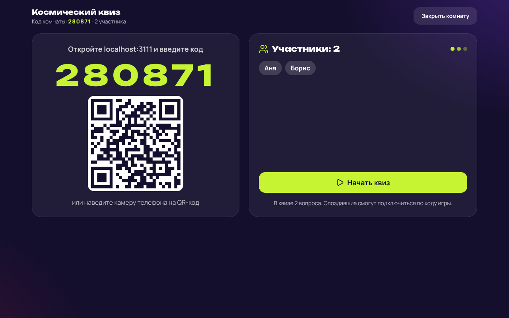

# КвизПульс

MVP платформы для интерактивных квизов на мероприятиях. Организатор собирает квиз и запускает
комнату, участники заходят с телефона по шестизначному коду или QR, вопросы появляются у всех
одновременно, баллы считаются на лету, в финале — пьедестал и лидерборд. Результаты сохраняются.



## Возможности

- Регистрация и вход для двух ролей: участник и организатор.
- Конструктор квизов: категория, время на вопрос, баллы, правила (бонус за скорость, автопереход,
  перемешивание вопросов и вариантов).
- Вопросы с текстом и картинкой, одиночный и множественный выбор, от 2 до 6 вариантов.
- Живая комната: вход по коду или QR, вопрос доступен для ответа только пока он на экране,
  таймер ведёт сервер.
- Подсчёт баллов, промежуточный и итоговый лидерборд, пьедестал победителей.
- Личный кабинет: мои квизы, история проведённых игр, история участия, разбор по вопросам.
- Играть можно и без регистрации; обновление страницы или обрыв связи не выбивают из игры.

## Запуск

Нужен Node.js 20+.

```bash
npm install
npm run build
npm start
```

Приложение откроется на http://localhost:3000. База SQLite создаётся сама в `data/quiz.db`.

Для разработки — два терминала: `npm run dev:server` и `npm run dev:client`
(интерфейс на http://localhost:5173 с горячей перезагрузкой).

В production задайте `JWT_SECRET` (см. `.env.example`). Есть `Dockerfile`:

```bash
docker build -t quizpulse .
docker run -p 3000:3000 -e JWT_SECRET=длинная-случайная-строка -v quizpulse-data:/app/data quizpulse
```

## Тесты

```bash
npm test
```

Интеграционные тесты поднимают настоящий сервер на временной базе и проходят игру через HTTP и
WebSocket: права, валидация, полный сценарий с баллами и историей, закрытие вопроса по таймеру,
бонус за скорость, переподключение, автопереход.

## Устройство

```
server/
  index.js          — Express + Socket.IO, раздача собранного интерфейса
  db.js             — схема SQLite
  auth.js           — JWT в httpOnly-куке, роли
  validate.js       — проверка квиза перед сохранением
  game.js           — игровой движок: комнаты, таймер, приём ответов, баллы
  routes/           — REST: вход, квизы, результаты и история
client/src/
  pages/            — главная, вход, кабинет, конструктор, экран организатора, экран участника, результаты
  components/       — общие элементы интерфейса и игровые блоки
  useRoom.js        — подключение к комнате по WebSocket
tests/              — интеграционные тесты
docs/               — пояснительная записка, модель данных, скриншоты
```

Стек: Node.js, Express 5, Socket.IO, SQLite (better-sqlite3), React 19, Vite, Tailwind CSS 4.
Подробности и обоснование выбора — в [пояснительной записке](docs/poyasnitelnaya-zapiska.md).

## Ограничения MVP

- Живые комнаты хранятся в памяти одного процесса: при перезапуске сервера идущие игры прерываются
  (сохранённые результаты не теряются), горизонтальное масштабирование потребует общего хранилища.
- Нет восстановления пароля и подтверждения email.
- Картинки сжимаются в браузере и хранятся в базе; для больших объёмов нужен файловый сторедж.
