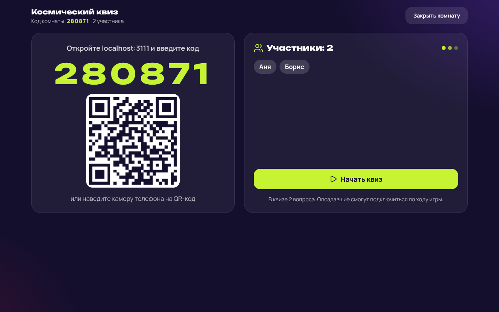
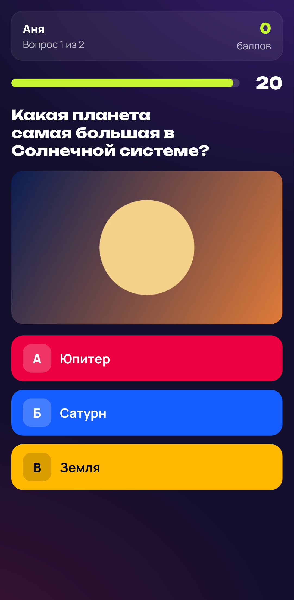
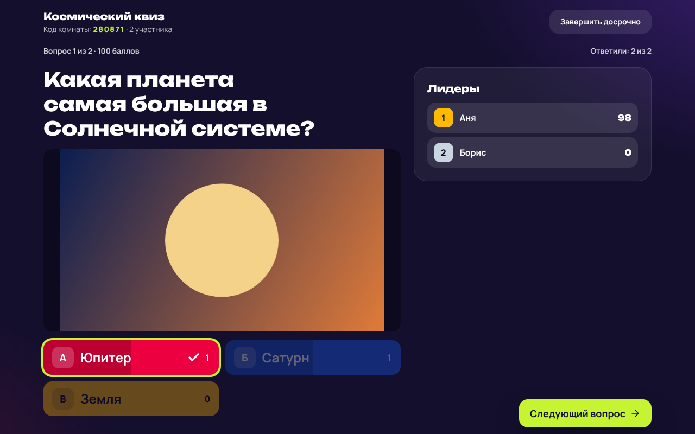
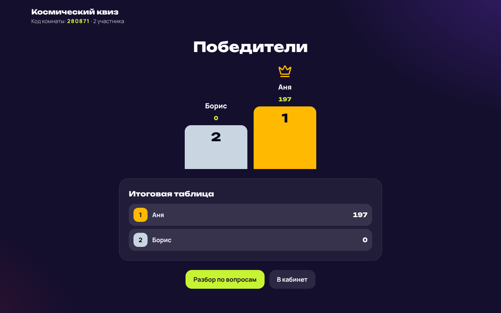

# Пояснительная записка

**Проект:** КвизПульс — веб-приложение для проведения интерактивных квизов в реальном времени.

**Ссылки (заполнить перед сдачей):**

- Репозиторий: https://github.com/Lyaviliy/quiz-platform
- Макеты (Figma / Miro): `<ссылка на макеты>`
- Работающий продукт: `<ссылка, если развёрнут>`

## 1. Задача и результат

Нужен MVP платформы, на которой организатор мероприятия проводит викторину, а зал отвечает
с телефонов. Готовый прототип закрывает весь сценарий:

| Требование | Как реализовано |
|---|---|
| Регистрация и авторизация участников и организаторов | Роль выбирается при регистрации; вход по email и паролю |
| Создание и настройка квизов | Конструктор: категория, время на вопрос, баллы, правила проведения |
| Вопросы разных типов | Текст и картинка; одиночный и множественный выбор; 2–6 вариантов |
| Запуск и подключение по коду комнаты | Шестизначный код и QR; вопрос виден всем одновременно и принимает ответы только пока идёт таймер |
| Подсчёт баллов и победители | Баллы за верный ответ, опционально бонус за скорость; лидерборд после каждого вопроса, пьедестал в финале |
| Личный кабинет с историей | Мои квизы, проведённые игры, история участия, разбор по вопросам |
| Сохранение данных | Все ответы и итоги пишутся в базу; история не теряется при правке или удалении квиза |

## 2. Выбор средств разработки

- **Node.js + Express** — серверная часть на JavaScript (требование задания); один язык на клиенте
  и сервере упрощает поддержку небольшой командой.
- **Socket.IO** — живое взаимодействие поверх WebSocket. Выбран вместо «голого» WebSocket ради
  автоматического переподключения, подтверждений доставки и запасного транспорта: на мероприятиях
  Wi-Fi часто нестабилен, а корпоративные сети иногда режут WebSocket.
- **SQLite (better-sqlite3)** — реляционная база в одном файле: не нужен отдельный сервер БД,
  прототип разворачивается одной командой. Схема обычная реляционная, переход на PostgreSQL при
  росте нагрузки не потребует менять модель.
- **React + Vite** — популярный фреймворк с быстрым циклом разработки; интерфейс игры — это
  отображение состояния, приходящего с сервера, и React подходит для этого естественно.
- **Tailwind CSS** — быстрая вёрстка адаптивного интерфейса без отдельной дизайн-системы.
- **JWT в httpOnly-куке, bcrypt** — вход без серверных сессий; токен недоступен скриптам страницы,
  пароли хранятся только в виде хеша.

## 3. Модель базы данных

```
users ──< quizzes ──< questions ──< options
  │          │
  │          └──< sessions ──< players ──< answers
  └── (host) ─────┘   │                      │
  └── (участник) ─────┴──────────────────────┘
categories ──< quizzes
```

- `users` — имя, email, хеш пароля, роль (`organizer` / `participant`).
- `categories` — справочник категорий вопросов.
- `quizzes` — название, описание, категория, время на вопрос и правила (бонус за скорость,
  перемешивание, автопереход).
- `questions`, `options` — вопросы (текст, картинка, тип, своё время, баллы) и варианты ответа
  с признаком правильности.
- `sessions` — проведённая игра: код комнаты, статус, время начала и конца, **снимок вопросов** на
  момент запуска. Благодаря снимку результаты остаются корректными, даже если квиз потом
  отредактировали или удалили.
- `players` — участник конкретной игры: имя на табло, баллы, место; связь с аккаунтом необязательна
  (гость).
- `answers` — каждый ответ: выбранные варианты, верно ли, баллы, время ответа.

## 4. Работа в реальном времени

Единственный источник правды — сервер. Он хранит состояние комнаты (лобби → вопрос → разбор →
… → финал), ведёт таймер и после каждого изменения рассылает каждому подключённому готовое
состояние экрана: организатору — со списком игроков и счётчиком ответивших, участнику — с его
баллами и местом. Это даёт три свойства, важных для мероприятия:

1. **Честность.** Правильные ответы не отправляются на телефоны, пока вопрос открыт; ответ после
   истечения времени сервер не принимает; картинку следующего вопроса нельзя получить заранее.
2. **Устойчивость.** После обрыва связи или обновления страницы клиент заново входит в комнату
   по сохранённому токену и сразу получает актуальный экран со своими баллами.
3. **Синхронность.** Таймер на телефоне считается от серверного времени, поэтому неверные часы
   устройства не дают форы.

Подсчёт баллов: за верный ответ начисляются баллы вопроса; с бонусом за скорость — от 100% за
мгновенный ответ до 50% на последней секунде. В вопросах с множественным выбором засчитывается
только точное совпадение набора. При равенстве баллов выше тот, кто отвечал быстрее.

## 5. Этапы разработки

1. **Проектирование интерфейса.** Пользовательские сценарии организатора и участника, карта
   экранов и макеты (Miro, Figma — ссылка выше). Ключевые решения: большой код и QR на экране
   организатора, крупные цветные кнопки с буквами на телефоне, вход в игру без регистрации.
2. **Модель данных.** Схема из раздела 3; отдельно продумано хранение истории через снимок.
3. **Серверная часть.** REST API для входа, квизов, истории и результатов; проверка всех входных
   данных; ограничение частоты попыток входа.
4. **WebSocket.** Игровой движок: комнаты, фазы игры, таймер, приём ответов, рассылка состояния,
   переподключение.
5. **Веб-интерфейс.** Адаптивные экраны: главная, вход, кабинет, конструктор, экран организатора
   (для проектора), экран участника (для телефона), результаты.
6. **Тестирование.** 12 автоматических интеграционных тестов (полная игра через HTTP и WebSocket,
   права, таймер, баллы, переподключение) и сквозной прогон в браузере: организатор на экране
   1280 px и два участника в режиме телефона. По итогам прогона исправлена ошибка: вопрос
   закрывался досрочно, если один из игроков обновлял страницу. Следующий шаг — проверка на
   группе реальных пользователей `<дополнить результатами>`.

## 6. Ограничения и развитие

Живые комнаты хранятся в памяти одного сервера — для MVP и мероприятий до нескольких сотен
участников этого достаточно; для масштабирования состояние комнат выносится в Redis, а база
переводится на PostgreSQL. Дальнейшие идеи: командный режим, открытые вопросы, экспорт
результатов, библиотека готовых квизов.

## Приложение. Экраны

| Экран организатора: лобби | Телефон участника: вопрос |
|---|---|
|  |  |

| Разбор вопроса | Финал |
|---|---|
|  |  |
